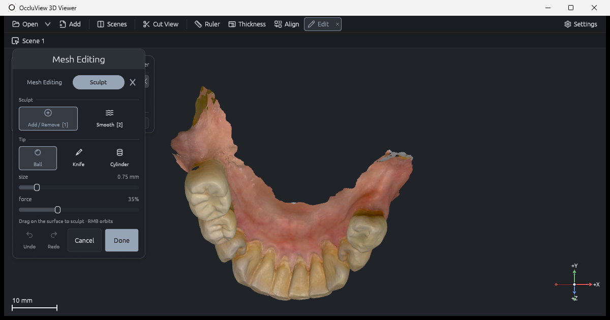
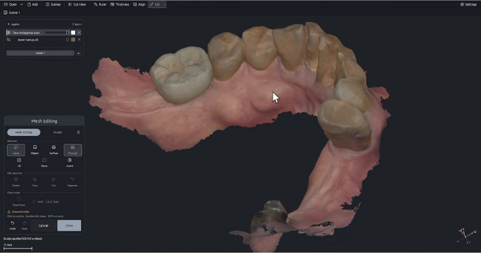
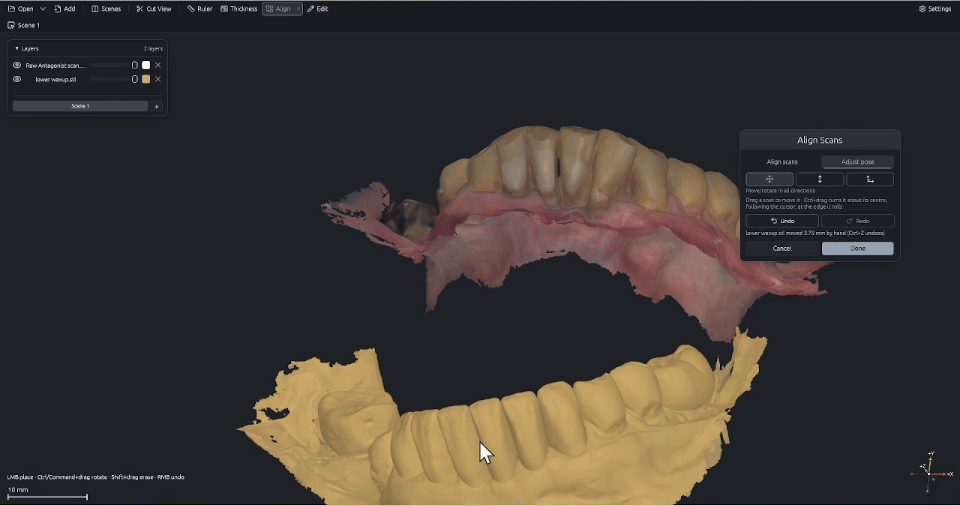
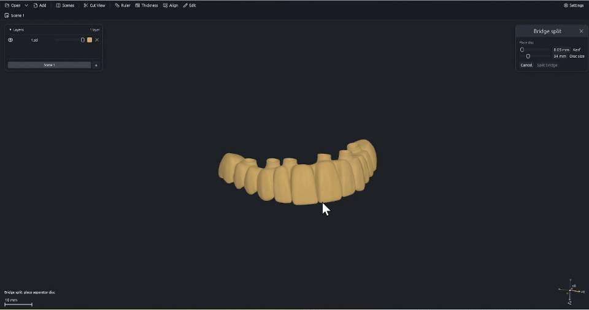
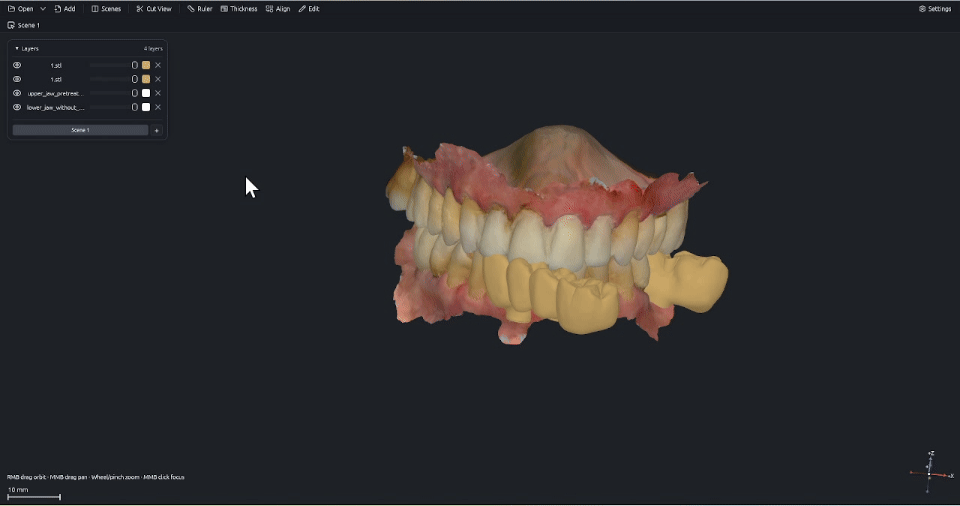
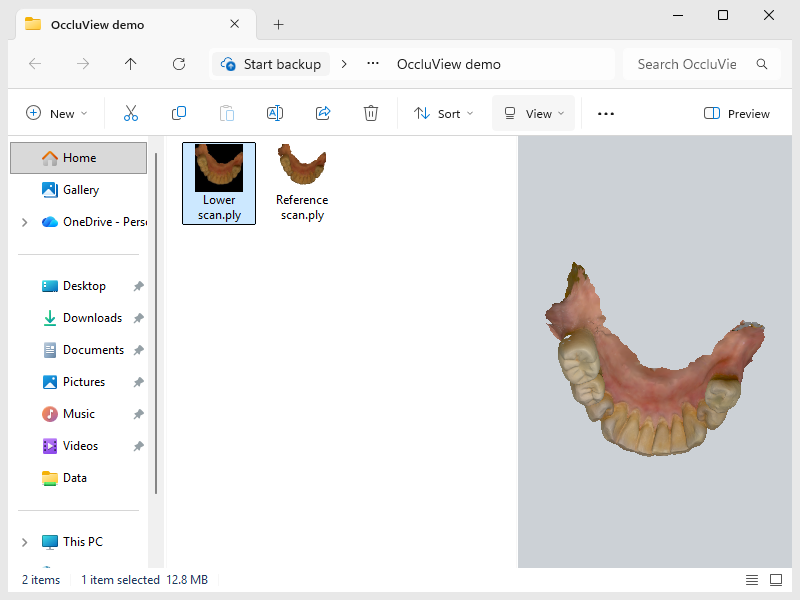

# OccluView

**A fast native Windows workspace for opening, comparing, and editing dental 3D scans.**

[Download for Windows](https://github.com/occlutrace/OccluView/releases/latest) · [All releases](https://github.com/occlutrace/OccluView/releases)

  

## Work with scans

- **Align** — position two scans and inspect their deviation on a color map with a millimeter scale.
- **Sculpt** — add, remove, or smooth local surface detail with adjustable brushes.
- **Bridge Split** — position a separator disc, preview the split, and apply it to a bridge.
- **Scenes** — keep two independent workspaces open and move scan layers between them.
- **Mesh Editing and Repair** — select, cut, crop, separate, and repair scan geometry; close safe pinholes.
- **Windows Explorer** — the installer adds scan thumbnails and an interactive Preview Pane.

Sculpt demo

Scan alignment demo

Bridge Split demo

Two-scene workflow

Windows Explorer preview

## Download

- [Windows Installer (.msi)](https://github.com/occlutrace/OccluView/releases/latest/download/OccluView-Windows-Setup.msi) — recommended; installs OccluView and Windows Explorer integration.
- [Windows Portable (.zip)](https://github.com/occlutrace/OccluView/releases/latest/download/OccluView-Windows-Portable.zip) — run without installing; does not add Explorer integration.

## File formats

Open STL, PLY, OBJ, GLB, and OFF files. Export meshes as STL, PLY, or OBJ. Textured PLY and OBJ files can use image textures stored alongside the model.

See [measurement definitions and unit decisions](docs/measurements.md) before
comparing readings from differently sampled meshes or ambiguous GLB exports.

## Project

- [Releases and downloads](https://github.com/occlutrace/OccluView/releases)
- [Report a problem](https://github.com/occlutrace/OccluView/issues)
- [Contributing](CONTRIBUTING.md)
- [License](LICENSE) — Apache-2.0
